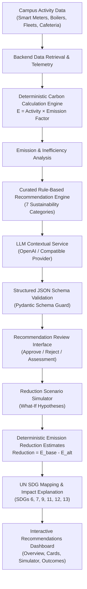

# 🌿 CampusCarbon AI: AI-Powered Sustainability Recommendation Platform

**CampusCarbon AI** is an institutional decarbonization and sustainability intelligence platform that combines **deterministic greenhouse gas (GHG) calculations**, a **curated sustainability rule library**, **configurable LLM natural language analysis**, an **interactive reduction scenario simulator**, and **UN Sustainable Development Goal (SDG) mapping**.

---

## 🏗️ System Architecture & Workflow



### Source of Truth Principle
- **The LLM is NEVER the source of numerical truth.** The LLM generates contextual reasoning, proposed interventions, and preliminary qualitative suggestions.
- **The Deterministic Carbon Calculation Engine is the absolute numerical authority.** All baselines, alternative scenarios, percentage reductions, and financial calculations are computed deterministically using approved emission factors (DEFRA, EPA eGRID, IPCC).
- **Offline / Resilient Fallback:** If the LLM API is unavailable, times out, or has no configured API key, the system seamlessly falls back to the curated rule-based sustainability catalog with zero downtime.

---

## 🧮 Deterministic Calculation Engine (Section 9 & 10)

### GHG Protocol Corporate Standard Formulations

$$E_{\text{baseline}} = A_{\text{baseline}} \times EF_{\text{baseline}}$$

$$E_{\text{alternative}} = A_{\text{alternative}} \times EF_{\text{alternative}}$$

$$\text{Potential Reduction } (kgCO_2e) = E_{\text{baseline}} - E_{\text{alternative}}$$

$$\text{Percentage Reduction } (\%) = \left( \frac{\text{Potential Reduction}}{E_{\text{baseline}}} \right) \times 100$$

$$\text{Annual Reduction } (tCO_2e/\text{year}) = \left( \frac{\text{Potential Reduction } \times 365}{1000} \right)$$

$$\text{Annual Financial Savings } (\$) = (A_{\text{baseline}} - A_{\text{alternative}}) \times \text{Cost Rate} \times 365$$

### Example Kitchen LPG Scenario (Section 10)
- **Baseline:** Commercial dining hall consuming **$80\text{ kg/day}$** of commercial LPG.
- **Approved Factor ($EF_{\text{LPG}}$):** $2.983\text{ kgCO}_2\text{e/kg}$ (DEFRA 2024).
- **Baseline Emissions:** $80 \times 2.983 = \mathbf{238.64\text{ kgCO}_2\text{e/day}}$.
- **Intervention Assumption:** $10\%$ reduction via high-efficiency pre-mix burners and flame tuning.
- **Alternative Consumption:** $80 \times (1 - 0.10) = \mathbf{72\text{ kg/day}}$.
- **Alternative Emissions:** $72 \times 2.983 = \mathbf{214.776\text{ kgCO}_2\text{e/day}}$.
- **Potential Reduction:** $238.64 - 214.776 = \mathbf{23.864\text{ kgCO}_2\text{e/day}}$ ($8.71\text{ tCO}_2\text{e/year}$).
- **Estimated Financial Savings:** $8\text{ kg/day} \times \$1.45/\text{kg} \times 365 = \mathbf{\$4,234.00/\text{year}}$.

---

## 📂 Category-Specific Sustainability Rules (Section 6)

1. **Electricity**: LED lighting retrofits with PIR occupancy controls; rooftop solar PV peak shaving and structural feasibility.
2. **Transportation**: Shuttle fleet route optimization; campus internal maintenance utility fleet electrification.
3. **Kitchen & LPG**: Pre-mix burner replacement and flame maintenance; biogas biomethanation pre-feasibility with strict feedstock and safety setback buffers.
4. **Food Waste**: Cafeteria preparation portioning and plate waste reduction; on-campus enclosed in-vessel aerobic composting (with avoided landfill methane methodology safeguards).
5. **Water & Wastewater**: Pumping network Variable Frequency Drives (VFDs) and acoustic leak abatement; decentralized greywater tertiary filtration for non-potable flushing and irrigation.
6. **Air Conditioning (HVAC)**: Chilled water setpoint optimization ($24^\circ\text{C}-25^\circ\text{C}$ ASHRAE 55) and schedule curtailment; condenser coil descaling and design COP restoration.
7. **Fabrication & Construction**: Machine shop idle power cut-offs and sub-metering; low-carbon Pozzolanic/slag blended cement substitution.

---

## 🌐 UN Sustainable Development Goals (SDG) Mapping

| SDG | Title | Focus Area in CampusCarbon AI | Example Measurable Indicator |
| :--- | :--- | :--- | :--- |
| **SDG 6** | Clean Water and Sanitation | Water pumping efficiency, leak abatement, greywater reuse | Target 6.4: Water-use efficiency ($m^3/\text{occupant-day}$) |
| **SDG 7** | Affordable and Clean Energy | Solar PV, lighting efficiency, HVAC setpoints | Target 7.2/7.3: Energy efficiency ($kWh/\text{saved}$) |
| **SDG 9** | Industry, Innovation and Infrastructure | Workshop sub-metering, blended cements, BMS | Target 9.4: Sustainable infrastructure retrofitting |
| **SDG 11** | Sustainable Cities and Communities | Transit route optimization, fleet electrification | Target 11.6: Per-capita settlement environmental impact |
| **SDG 12** | Responsible Consumption and Production | Food waste reduction, kitchen LPG efficiency | Target 12.3: Per capita food waste reduction |
| **SDG 13** | Climate Action | Scope 1, 2, and 3 GHG reduction interventions | Target 13.2: Institutional emissions abatement targets |

---

## ⚖️ Transparent Recommendation Prioritization Scoring

Every recommendation receives a deterministic prioritization score ($0 - 100$):

$$\text{Score} = 0.35 \times S_{\text{reduction}} + 0.25 \times S_{\text{confidence}} + 0.20 \times S_{\text{feasibility}} + 0.20 \times S_{\text{financial}} - \text{Penalty}_{\text{safety/risk}}$$

- **Reduction Impact ($35\%$)**: Based on percentage reduction potential.
- **Data Confidence ($25\%$)**: High confidence for measured baselines, penalty for estimated/unmetered elements.
- **Operational Feasibility ($20\%$)**: Penalties for high implementation constraints or required facilities downtime.
- **Financial Viability ($20\%$)**: Assesses payback and recurring tariff savings.
- **Safety / Regulatory Safeguard**: Substantial penalty if safety or regulatory prerequisites are unresolved (e.g. biogas buffer zones).

---

## 🚀 Quickstart Guide (One-Click Launch)

### Prerequisites
- **Python 3.10+** (Python 3.12 / 3.13)
- **Node.js 18+** (Node.js 20 / 22)
- **Docker Desktop** (for PostgreSQL 16 container)

---

### Option A: One-Click Startup (Recommended)

#### On Windows:
Double-click `start.bat` in File Explorer, or run in PowerShell / Command Prompt:
```powershell
.\start.bat
# or in PowerShell:
.\start.ps1
```

#### On Linux / macOS / WSL:
```bash
chmod +x start.sh stop.sh
./start.sh
```

#### Cross-Platform Python Orchestrator:
```bash
python run.py
```

The orchestrator automatically:
1. Connects to or launches Docker Desktop and starts the PostgreSQL 16 container (`campuscarbon_postgres`).
2. Validates database connectivity and runs any pending Alembic migrations.
3. Spawns the FastAPI backend (port 8000) and Vite frontend (port 5173).
4. Verifies health probes on all endpoints.
5. Automatically opens `http://localhost:5173` in your default browser.
6. Gracefully shuts down all processes when you press `Ctrl+C`.

---

### Useful CLI Commands

```powershell
# Check live health status of all components:
python run.py --status
# or: .\start.ps1 -Status

# Force-restart any lingering services:
python run.py --restart
# or: .\start.ps1 -Restart

# Stop running backend and frontend services:
.\stop.bat
# or in PowerShell: .\stop.ps1
# or: python run.py --stop

# Stop all services including the PostgreSQL Docker container:
python run.py --stop-all
# or: .\stop.ps1 -All
```

---

### Service URLs

| Service | URL | Description |
| :--- | :--- | :--- |
| **Frontend Web App** | `http://localhost:5173` | React 18 + TypeScript + Vite UI |
| **Backend REST API** | `http://localhost:8000` | FastAPI server & calculation engine |
| **Interactive API Docs** | `http://localhost:8000/docs` | Swagger UI documentation |
| **PostgreSQL Database** | `localhost:5432` | Container `campuscarbon_postgres` |

---

### Automated Testing

To run the complete verification suites:
```powershell
# Backend pytest suite (65 tests)
python -m pytest backend/tests -v

# Frontend vitest suite (43 tests)
cd frontend && npm.cmd test -- --run

# TypeScript production build check
cd frontend && npm.cmd run build
```

---

## 🔒 Security & Privacy Practices
- **Backend-only LLM credentials:** API keys are never bundled in client code or committed to version control.
- **Data minimization:** Telemetry data sent to external LLMs is stripped of PII and internal security records.
- **Role-Based Access Control (RBAC):** Restricts generation, approval, rejection, and implementation to authorized roles (`admin`, `facility_manager`), while maintaining read-only views for `viewer`.
- **Campus Isolation:** Enforces multi-tenant data boundaries at the database query level.
