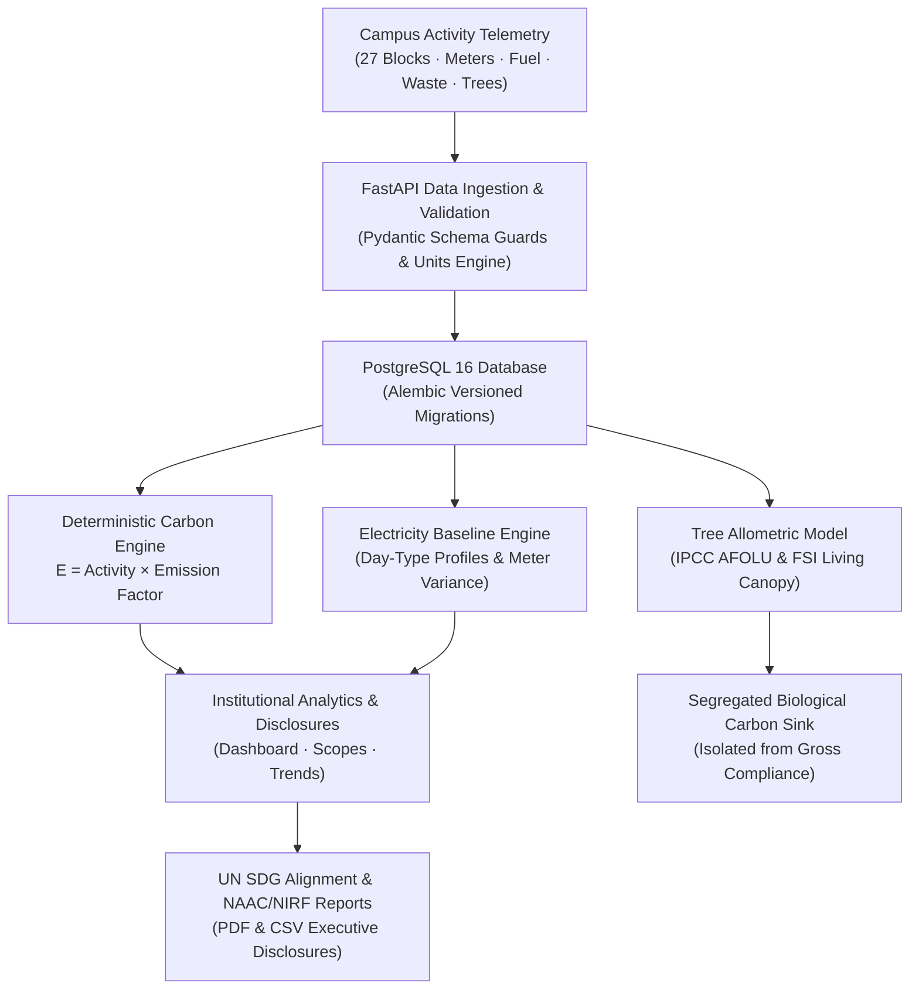

# 🌿 CampusCarbon AI: Institutional Digital MRV & Carbon Accounting Platform

[](https://www.typescriptlang.org/)
[](https://www.python.org/)
[](https://fastapi.tiangolo.com/)
[](https://react.dev/)
[](https://tailwindcss.com/)
[](https://www.postgresql.org/)
[](https://www.docker.com/)
[](https://github.com/sanjaygurusamy/Cred_gen)

**CampusCarbon AI** is an institutional digital **Measurement, Reporting, and Verification (MRV)** and carbon intelligence platform developed for **Amrita Vishwa Vidyapeetham — Coimbatore Campus (`AVV-CBE`)**.

It pairs **deterministic greenhouse gas (GHG) accounting** (GHG Protocol Corporate Standard) with **sub-metered electricity baselines**, **botanical allometric carbon sequestration (IPCC AFOLU)**, **UN Sustainable Development Goal (SDG) alignment**, and **audit-grade executive reporting (NAAC Criteria 7 & NIRF Green Campus)**.

---

## 🏛️ Institutional Scope: Amrita Coimbatore (`AVV-CBE`)

- **Physical Campus**: Amrita Vishwa Vidyapeetham, Ettimadai, Coimbatore, Tamil Nadu, India.
- **27 Canonical Campus Blocks**: Academic Blocks 1–3, Central Library, CIR, Mega Mess, Hostels A–K, Research Centers, Health Centre, Sports Complex, and Utility/STP Plants.
- **Gross Emissions Boundary**: Scope 1 (Diesel generators, kitchen LPG, fleet transport), Scope 2 (Grid electricity via CEA v20 grid factor, on-site solar PV generation), and Scope 3 (Municipal water withdrawal, STP wastewater, food waste composting, paper/plastic recycling, and e-waste).
- **Segregated Biological Carbon Sink**: Campus tree census across 8 dominant native species (Neem, Teak, Banyan, Gulmohar, Bamboo, Peepal, Mango, Pongamia) and dedicated green spaces calculated using IPCC AFOLU & Forest Survey of India (FSI) growth curves.

---

## 🏗️ System Architecture & Workflow



### The Source of Truth Principle
1. **Deterministic Authority**: Numerical calculations are 100% deterministic, transparent, and reproducible. Every emission record stores its formula, activity quantity, conversion unit, factor citation, and calculation version.
2. **Double-Counting Prevention**: Secondary readings, superseded measurements, and unmetered estimations are strictly isolated.
3. **Biological Sink Segregation**: Carbon sequestration in trees is displayed as a distinct biological sink and is never subtracted from gross Scope 1/2/3 totals to guarantee regulatory audit integrity.

---

## 📂 Repository Directory Structure

```text
├── backend/                        # FastAPI Application & Business Logic
│   ├── alembic/                    # Database migration environment
│   │   └── versions/               # Production schema migration versions
│   ├── app/
│   │   ├── api/v1/endpoints/       # 12 REST API route modules
│   │   ├── core/                   # Config, database pools, SDG catalog, unit conversions
│   │   ├── models/                 # SQLAlchemy 2.0 ORM data models
│   │   ├── schemas/                # Pydantic request/response validation schemas
│   │   ├── services/               # Carbon engine, reporting engine, tree service, seeders
│   │   └── main.py                 # FastAPI application entrypoint & middleware
│   ├── tests/                      # Pytest verification suites (82 tests)
│   ├── alembic.ini                 # Alembic migration configuration
│   └── requirements.txt            # Python dependencies
├── frontend/                       # React 18 + TypeScript + Vite Dashboard
│   ├── src/
│   │   ├── __tests__/              # Vitest UI & integration tests (53 tests)
│   │   ├── api/client.ts           # Centralized Axios API client
│   │   ├── components/
│   │   │   ├── common/             # Reusable UI widgets & UN SDG visual vector emblems
│   │   │   └── layout/             # Shell layout, sidebar, and live telemetry header
│   │   ├── context/                # System status & connectivity state provider
│   │   ├── pages/                  # 12 Institutional views (Dashboard, Blocks, Trees, etc.)
│   │   ├── types/index.ts          # TypeScript domain type definitions
│   │   ├── App.tsx                 # Client-side router & route metadata
│   │   ├── index.css               # Global Tailwind CSS styling
│   │   └── main.tsx                # React DOM entrypoint
│   ├── package.json                # Frontend dependencies & scripts
│   ├── tailwind.config.js          # Tailwind CSS design system tokens
│   ├── tsconfig.json               # TypeScript compiler configuration
│   └── vite.config.ts              # Vite bundler configuration
├── docs/                           # Architecture & Engineering Specifications
│   ├── audit/                      # Phase 1-6 Technical audit findings & changelogs
│   ├── ARCHITECTURE.md             # High-level system architecture specification
│   ├── DATABASE_SCHEMA.md          # Complete entity-relationship diagram & tables
│   ├── DOMAIN_SPECIFICATION.md     # Campus emissions domain rules & definitions
│   ├── LEGACY_KNOWLEDGE_BASE.md    # Preserved rules, algorithms & simulation models
│   └── PHASED_PLAN.md              # Phased execution roadmap
├── docker-compose.yml              # PostgreSQL 16 container definition
├── run.py                          # Cross-platform Python startup orchestrator
├── start.bat / start.ps1 / start.sh# 1-Click platform launch scripts (Windows & Linux/macOS)
├── stop.bat / stop.ps1 / stop.sh   # 1-Click graceful shutdown scripts
├── .env.example                    # Sample environment variables
└── README.md                       # Comprehensive platform documentation
```

---

## 🧮 Mathematical Formulations

### 1. Deterministic GHG Accounting (Scopes 1, 2, and 3)
$$E_{\text{emission}} = A_{\text{activity}} \times EF_{\text{factor}}$$

- **Grid Electricity (Scope 2)**: CEA CO2 Baseline Database for the Indian Grid (Version 20, $0.716\text{ kg CO}_2\text{e/kWh}$).
- **Solar Photovoltaics (Scope 2)**: Direct emissions equal $0.00\text{ kg CO}_2\text{e}$ with avoided grid footprint tracking.
- **Diesel Stationary Combustion (Scope 1)**: $2.68\text{ kg CO}_2\text{e/L}$.
- **Commercial LPG (Scope 1)**: $2.983\text{ kg CO}_2\text{e/kg}$.
- **Food Waste Composting (Scope 3)**: $0.006\text{ kg CO}_2\text{e/kg}$ organic waste.

### 2. Biological Carbon Sequestration (Trees & Living Canopy)
$$S_{\text{annual}} = \sum_{i=1}^{N_{\text{species}}} \left( C_i \times R_i \times \frac{44}{12} \right)$$

Where:
- $C_i$: Standing tree count of species $i$.
- $R_i$: Species-specific annual carbon sequestration rate (kg C/tree/year) derived from FSI/IPCC forestry benchmarks.
- $\frac{44}{12}$: Molecular conversion factor from elemental carbon ($C$) to carbon dioxide equivalent ($\text{CO}_2\text{e}$).

---

## 🌐 UN Sustainable Development Goals (SDG) Alignment

CampusCarbon AI features built-in vector emblems and metrics for 6 core goals:

| SDG | Goal Name | Institutional Focus at Amrita |
| :---: | :--- | :--- |
| **SDG 6** | Clean Water & Sanitation | Water withdrawal metering, STP greywater tertiary treatment & recycling. |
| **SDG 7** | Affordable & Clean Energy | 27-block energy baselines, rooftop solar PV arrays, and LED retrofits. |
| **SDG 11** | Sustainable Cities & Communities | Low-carbon campus transit routes, living green space allocation. |
| **SDG 12** | Responsible Consumption & Production | Dining hall food waste measurement, anaerobic bio-methanation, scrap recycling. |
| **SDG 13** | Climate Action | Continuous Scope 1/2/3 digital MRV and auditable emission reductions. |
| **SDG 15** | Life on Land | Campus tree census (Neem, Teak, Banyan) and survival monitoring across plantations. |

---

## 🚀 Quickstart Guide (One-Click Launch)

### Prerequisites
- **Python 3.11+**
- **Node.js 18+**
- **Docker Desktop** (for PostgreSQL 16 container)

---

### Option A: One-Click Startup (Recommended)

#### On Windows:
Double-click `start.bat` in File Explorer, or run in PowerShell / Command Prompt:
```cmd
.\start.bat
```
*(Or in PowerShell: `.\start.ps1`)*

#### On Linux / macOS / WSL:
```bash
chmod +x start.sh stop.sh
./start.sh
```

#### Via Python Orchestrator:
```bash
python run.py
```

The orchestrator automatically:
1. Connects to or starts the PostgreSQL 16 container (`campuscarbon_postgres`).
2. Runs all pending Alembic database migrations.
3. Idempotently verifies and seeds the 14-day multi-domain campus demonstration dataset.
4. Starts the FastAPI backend (port `8000`) and Vite frontend (port `5173`).
5. Launches your default browser to `http://localhost:5173`.
6. Streams live colored logs and safely handles `Ctrl+C` shutdowns.

---

### Option B: Stopping Services
```cmd
.\stop.bat
```
*(Or: `.\stop.ps1` / `./stop.sh` / `python run.py --stop`)*

To stop all services including the Docker PostgreSQL container:
```bash
python run.py --stop-all
```

---

## 🌐 Service Access Endpoints

| Service | Address | Description |
| :--- | :--- | :--- |
| **Frontend Web Application** | `http://localhost:5173` | React 18 + TypeScript + Vite Dashboard |
| **Backend REST API** | `http://localhost:8000` | FastAPI server & calculation engine |
| **Swagger Interactive Docs** | `http://localhost:8000/docs` | OpenAPI specification & test sandbox |
| **PostgreSQL Database** | `localhost:5432` | Container `campuscarbon_postgres` |

---

## 🧪 Verification & Automated Testing

The entire platform is backed by comprehensive test coverage:

```powershell
# 1. Run all 82 backend pytest tests
python -m pytest backend/tests -v

# 2. Run all 53 frontend Vitest component & page tests
cd frontend
npx vitest run

# 3. Verify TypeScript type safety
npx tsc --noEmit

# 4. Verify production bundle build
npx vite build
```

**Quality Status**:
- Backend: **82 / 82 tests passing** (100%)
- Frontend: **53 / 53 tests passing** (100%)
- TypeScript: **0 compilation errors**
- Vite Build: **Clean production build** (~24s)

---

## 🔒 Security & Data Integrity Safeguards
- **Tamper-Evident Logs**: Calculation parameters, emission factor citations, and version stamps are permanently recorded.
- **Environment Isolation**: Secret keys and database credentials reside strictly in `.env` (never committed to Git).
- **Graceful Offline Fallback**: The test runner and application feature automatic fallback capabilities when Docker is offline.
- **Institutional Compliance**: Designed in accordance with NAAC Criteria 7, NIRF Green Campus, and GHG Protocol standards.
