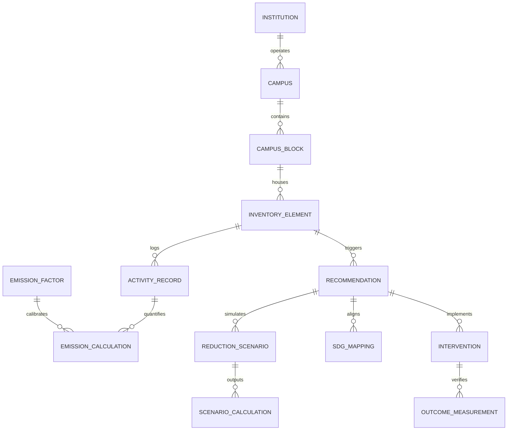

# CampusCarbon AI — Database Architecture & Schema Specification

## 1. Overview & Database Standards
- **Engine**: PostgreSQL 16
- **ORM**: SQLAlchemy 2.0 (using 2.0 declarative syntax and type-annotated mapped attributes)
- **Migrations**: Alembic version-controlled migration tree
- **Conventions**:
  - Table names: Plural, lowercase snake_case (e.g. `campuses`, `campus_blocks`, `emission_factors`).
  - Primary keys: UUIDv7 or UUIDv4 stored as native `uuid` columns for robust distributed identification.
  - Foreign keys: Explicitly constrained with referential integrity (`ON DELETE CASCADE` or `RESTRICT`).
  - Timestamps: UTC `created_at` and `updated_at` (timezone-aware `TIMESTAMP WITH TIME ZONE`).
  - Auditing: All emission calculations record exact `emission_factor_id`, methodology citation, and calculated timestamps.

---

## 2. Entity Relational Model (ERD)

---

## 3. Core Table Specifications

### A. Campus & Organizational Hierarchy
1. **`institutions`**: Top-level entity (e.g. university system).
2. **`campuses`**: Specific physical campus (e.g. GreenTech University Main Campus, `GTU-MAIN`).
3. **`campus_blocks`**: Physical zones and buildings (dining halls, hostels, labs, utility plants).
4. **`inventory_elements`**: Equipment, meters, fleet sub-groups, or physical processes emitting GHG.

### B. Activity & Telemetry
5. **`activity_definitions`**: Catalog of measurable physical parameters and compatible units (`kWh`, `liter`, `kg`, `m³`).
6. **`activity_records`**: Time-stamped daily/interval operational consumption data with data quality flags (`measured`, `supplied`, `estimated`).

### C. Greenhouse Gas Accounting & Emission Factors
7. **`emission_factors`**: Official emission factors with citation (DEFRA, EPA eGRID, IPCC), version year, factor value, unit, and geographical applicability.
8. **`emission_calculations`**: Deterministic calculations ($E = A \times EF$) with complete traceability.

### D. Recommendations, Scenarios & Evidence (MRV)
9. **`recommendations`**: Prioritized sustainability interventions across the 7 categories.
10. **`reduction_scenarios`**: What-If scenario hypotheses and parameter overrides.
11. **`scenario_calculations`**: Deterministic outcomes ($E_{baseline}$, $E_{alt}$, $\Delta E$, annual savings).
12. **`sdg_mappings`**: Mapping interventions to UN Sustainable Development Goals (SDG 6, 7, 9, 11, 12, 13).
13. **`intervention_implementations`**: Commissioned projects with capital costs and commissioning dates.
14. **`outcome_measurements`**: Measured post-telemetry verifying actual performance against baseline.
15. **`audit_evidence`**: Tamper-evident hash and document attachments supporting dMRV compliance.
