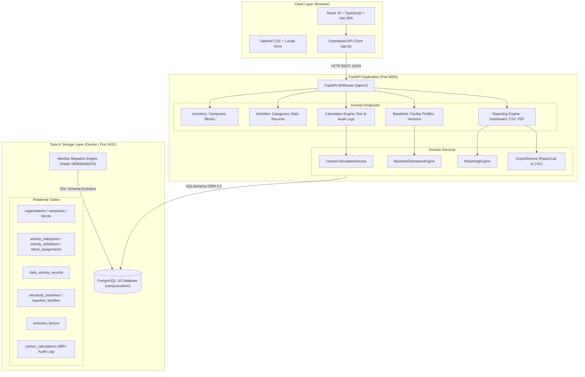
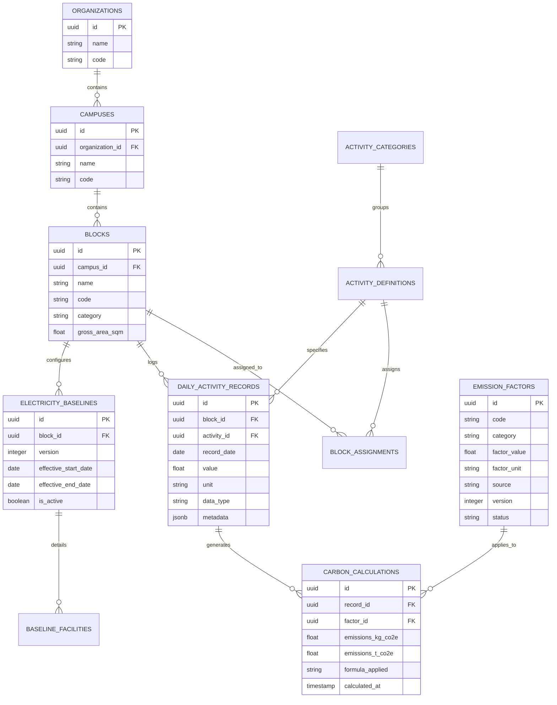
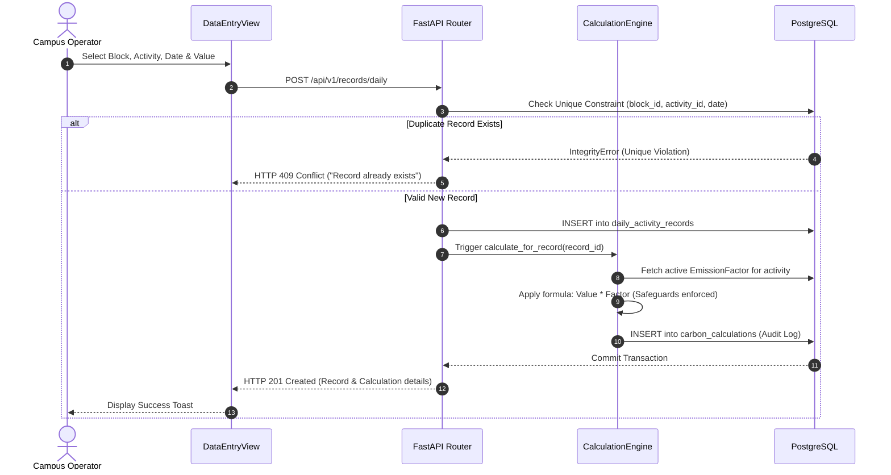
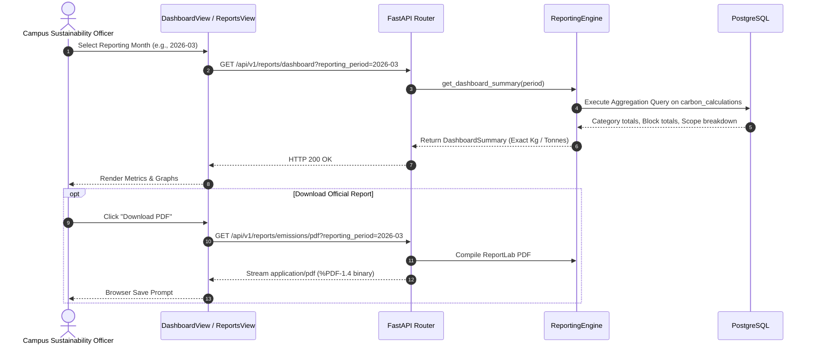

# CampusCarbon AI — Audit Deliverable: Architecture & Data Flow

**Organization:** Amrita Vishwa Vidyapeetham  
**Campus:** Coimbatore Campus (`AVV-CBE`)  
**Scope:** Phases 1–6 Architectural Blueprint & Data Flow  
**Date:** October 2026  

---

## 1. High-Level System Architecture

CampusCarbon AI is designed as a modular, decoupled full-stack greenhouse gas accounting platform. The frontend single-page application communicates with a high-performance Python FastAPI backend over REST, with PostgreSQL serving as the single source of truth for relational inventory, operational activity data, emission factors, and immutable calculation logs.

---

## 2. Major Components & Responsibilities

### 2.1 Frontend Components (`frontend/src/`)
1. **`App.tsx` & Router:** Root layout coordinating global navigation, header institutional identity, and view switching.
2. **`InventoryView.tsx`:** Displays the campus structure for Amrita Vishwa Vidyapeetham and Coimbatore Campus (`AVV-CBE`), rendering the 27 blocks across their 7 canonical categories.
3. **`DataEntryView.tsx`:** Manages daily activity data entry, with date selectors, block selection, category-filtered activity forms, positive metric validation, and duplicate entry safeguards.
4. **`BaselineView.tsx`:** Manages facility profiles (lighting, AC, lab equipment, computing) per block, enabling revision management and historical estimate protection.
5. **`DashboardView.tsx`:** Executive dashboard presenting calculated Scope 1, 2, and 3 emissions, category breakdowns, block rankings, and measured vs. estimated coverage. Renders honest empty states (`—` dashes) for unrecorded periods.
6. **`ReportsView.tsx`:** Download manager for reporting period selection, live streaming of RFC 4180 CSV logs, and ReportLab PDF executive summaries.
7. **`src/services/api.ts`:** Typed HTTP client parsing responses, transforming date formats, handling backend errors, and providing typed async methods for all backend resources.

### 2.2 Backend Modules (`backend/app/`)
1. **`main.py`:** Application entry point configuring CORS, lifespan database initialization, and mounting API routers.
2. **`core/database.py`:** Engine configuration (`postgresql+psycopg2`), sessionmaker factory, and `get_db()` dependency injection with deterministic session lifecycle.
3. **`models/`:** Declarative SQLAlchemy 2.0 ORM models defining entities, constraints, foreign keys, and indexes.
4. **`schemas/`:** Pydantic v2 schemas validating request inputs and defining serialization envelopes for all responses.
5. **`services/calculation_engine.py`:** Pure, deterministic GHG calculation engine multiplying activity metrics by verified emission factors. Applies the 10 GHG accounting safeguards.
6. **`services/baseline_engine.py`:** Computes daily estimated electricity for blocks based on facility power ratings (kW) and operating hours. Isolates baseline revisions to protect historical records.
7. **`services/reporting_engine.py`:** High-performance SQL aggregation service synthesizing emissions by category, block, and scope, with strict mathematical parity guarantees.
8. **`services/export_service.py`:** Generates streaming RFC 4180 CSV files and compiled ReportLab PDF executive reports with Amrita branding.

---

## 3. Entity-Relationship Data Model

---

## 4. Critical Data Flows

### 4.1 Daily Activity Entry & Deterministic Calculation Flow

### 4.2 Dashboard Aggregation & Export Flow

